# H3 — Textual Analysis of Thinking Traces

**Hypothesis folder:** `src/notebooks/h3-texual_analysis-of-thinking-traces/`
**Question H3 answers:** *What does the model actually do inside its thinking trace, and how does that inner behaviour differ between (a) longer and shorter samples of the same question and (b) correct and incorrect samples of the same question — and finally, how do the three outcome groups (ALL-CORRECT / MIXED / ALL-WRONG) differ from each other?*

| | |
|---|---|
| **Model analysed** | `r1-llama8b` (Llama-3.1-8B, R1-style reasoning distillation) |
| **Data** | `src/data/processed/r1-llama8b/r1-llama8b_raw_results_segmented_labeled.csv` (106 MB, 9,388 rows / 270 questions — see §2) |
| **Notebooks** | [`0.sentence_segmentation.ipynb`](0.sentence_segmentation.ipynb) → [`1.reasoning_trace_labeler.ipynb`](1.reasoning_trace_labeler.ipynb) → [`2_reasoning_trace_trajectory_analysis.ipynb`](2_reasoning_trace_trajectory_analysis.ipynb) |
| **Results** | `src/results/r1-llama8b/textual_analysis/` — 4 overview figures, 15 example figures, 5 tables (also bundled as `textual_analysis.zip`) |
| **Analysis type** | Observational / descriptive. No LLM inference in the analysis stage, no new labels, **no causal claims**. |

**At a glance:** 9,388 traces in scope → 8,038 labelled by the segment labeller → 410,887 segments carrying a `discourse_role`/`answer_status`/`temporal_role` label → 6,575 traces pass the eligibility funnel → 270 questions → 3 within-question contrasts + 1 five-condition group comparison, each summarised with question-level bootstrap confidence intervals.

---

## 1. Executive summary

1. **Extra compute is not spent on re-reading the question.** In ALL-WRONG questions the longest samples devote only **4.9 %** of their words to `setup` versus **29.7 %** in the shortest samples (Δ = −0.248, dz = −2.71, CI [−0.297, −0.196]); the freed budget goes almost entirely into `reasoning` (65.8 % → 87.9 %).
2. **Long wrong traces loop.** Their 4-gram repetition share rises from **0.037 → 0.222** (dz = 2.14) while lexical **novelty collapses from 0.665 → 0.253** (dz = −3.31): a long failing trace re-states content it has already produced instead of exploring new content. Long correct traces show the same direction but far weaker (novelty 0.691 → 0.513, repetition 0.025 → 0.066).
3. **Doubt starts earlier when the run is going badly.** In ALL-WRONG the first `doubt` segment appears at **13.6 %** of the trace in long samples versus **47.1 %** in short ones (dz = −2.60); in MIXED, incorrect samples doubt *later* than correct ones (+3.3 % of the trace, dz = 0.18).
4. **Verification is the clearest marker of correct samples.** MIXED correct samples give `verification` a **0.025** word share vs **0.016** for incorrect ones (dz = −0.24, p = 0.0025) and enter verification phases 0.019 times per 100 words more often. In ALL-CORRECT questions *short* samples contain **zero** doubt and verification words, while *long* correct samples contain 1.8 % doubt and **8.7 % verification** (dz = 1.81).
5. **When the model is right, the answer arrives early and the tail is check-work.** In ALL-CORRECT questions the first answer candidate sits at **66.5 %** of a long trace but at **96.0 %** of a short one (dz = −2.39): **33.5 %** of a long correct trace is written *after* the answer exists, versus 4.0 % of a short one.
6. **Answer churn is an outcome-linked signal, not a length artifact.** Within MIXED questions an answer is replaced at least once in **23.8 %** of correct vs **17.7 %** of incorrect samples (dz = −0.20, p = 0.009) — but the raw replacement *rate per 100 words* is statistically indistinguishable (0.058 vs 0.057).
7. **Correct samples are longer than incorrect ones *inside the same MIXED question*** (mean 908 vs 736 words; Δ log-words −0.246, dz = −0.41), i.e. the familiar "more thinking helps" correlation shows up again at the within-question level.
8. **Between groups the picture is monotone:** `rep4_share` 0.025 (ALL-CORRECT short) → 0.066 (long) → 0.078/0.094 (MIXED incorrect/correct) → **0.120** (ALL-WRONG), and "no annotated answer value" 0 % → 8.3 % → 46.1 %/35.9 % → **47.5 %** — with the caveat of §10 that the groups contain different questions.

---

## 2. Context and scope

The TTCA project is split into three analysis hypotheses:

| Folder | Hypothesis | Unit of analysis |
|---|---|---|
| `h1-overbenchmark_analysis` | How do compute levels relate to accuracy, latency and token efficiency — over benchmarks? | compute level × benchmark |
| `h2-overmodel_analysis` | Are the H1 patterns universal across models or model-specific? | model |
| **`h3-texual_analysis-of-thinking-traces`** | **What happens *inside* the thinking trace?** | **question** (pooled samples) |

H3 deliberately changes the lens: instead of treating a sample as a row of numbers (accuracy, tokens, latency), it decomposes the trace into sentences, labels every sentence with its discourse function, and then reconstructs the *trajectory* of a reasoning attempt — where the model doubts, where it checks, where it commits to an answer, how often it repeats itself, and how much of the trace is still ahead once an answer exists.

**Scope decisions (inherited from the pipeline):**

* **Rows in scope.** The analysed file holds **9,388 rows covering all 270 questions** of the committed raw sweep (`9 benchmarks × 30 questions × 7 compute levels × 5 samples = 9,450 rows`, 1,050 per benchmark), minus 62 rows — every one of them at compute level `8192`. Keys `(benchmark, question_id, compute_level, sample_index)` are unique and the question set is identical to the raw file's.
* **Provenance flag.** The labeler notebook *as committed* runs with `CFG.SECOND_HALF_ONLY=True` (keep only `len(df)//2:` of its input). The produced 9,388 rows are exactly half of 18,776 and at the same time cover the whole committed sweep minus the 62 rows above — so the Kaggle-side `r1-llama8b_raw_results_segmented.csv` evidently held more rows than a straight segmentation of the committed raw file (most plausibly two copies of each row). Nothing is double-counted (all keys are unique), and the 62 absent `8192` rows are simply never analysed.
* **Compute levels present:** 0 (1,350 rows), 256, 512, 1024, 2048, 4096 (1,350 each) and 8192 (1,288 rows); the 1,350 rows at level `0` have no thinking text at all (skipped by the labeller); 1,008 rows are truncated (`was_truncated = True`); 4,265 correct / 5,123 incorrect.
* **Length is measured in words** of `thinking_text` after `<br>` → space and removal of zero-width characters — never in tokens, so it is comparable across benchmarks.

---

## 3. Data and pipeline

```
src/data/raw/r1-llama8b/r1-llama8b_raw_results.csv          (raw sweep)
        │
        │  0.sentence_segmentation.ipynb        lossless ⟦S1⟧ ⟦S2⟧ … markers
        ▼
r1-llama8b_raw_results_segmented.csv          (intermediate, lives on Kaggle)
        │
        │  1.reasoning_trace_labeler.ipynb      Qwen3.5-9B labels every segment
        ▼
r1-llama8b_raw_results_segmented_labeled.csv  (106 MB — the analysis input)
        │                                     + rtl_status / rtl_n_segments / rtl_labels_json
        │  2_reasoning_trace_trajectory_analysis.ipynb
        ▼
src/results/r1-llama8b/textual_analysis/
        ├── figures/  4 overview PNGs + examples/{ALL-CORRECT,MIXED,ALL-WRONG}/ 5 each
        └── tables/   question_groups.csv, 3 effect tables, group_comparison.csv
```

### 3.1 Artifact inventory

| Artifact | Path | Size / content |
|---|---|---|
| Raw sweep | `src/data/raw/r1-llama8b/r1-llama8b_raw_results.csv` | 17 columns, full 9-benchmark sweep |
| Analysis input | `src/data/processed/r1-llama8b/r1-llama8b_raw_results_segmented_labeled.csv` | 106 MB, 20 columns, **9,388 rows** |
| Overview figures | `…/textual_analysis/figures/overall_*.png` | 4 PNG, 1993–2217 × 1257–1274 px |
| Example figures | `…/textual_analysis/figures/examples/<GROUP>/<qkey>.png` | 15 PNG, ~1400 × 2200–2400 px |
| Question table | `…/textual_analysis/tables/question_groups.csv` | 270 rows (one per question) |
| Effect tables | `…/tables/{ALL-CORRECT,ALL-WRONG}_long_vs_short.csv`, `…/MIXED_incorrect_vs_correct.csv` | 34 features × 10 columns each |
| Group comparison | `…/tables/group_comparison.csv` | 11 features × 5 conditions |
| Bundle | `src/results/r1-llama8b/textual_analysis.zip` | 4.4 MB, identical content |

The labeler appended three columns to the original 17:

| Column | Meaning |
|---|---|
| `rtl_status` | `labeled` (8,038 rows) or `skipped: no thinking text` (1,350 rows) |
| `rtl_n_segments` | number of `⟦S#⟧` segments in the trace |
| `rtl_labels_json` | JSON array, one object per segment: `segment_id`, `note`, `discourse_role`, `answer_status`, `answer_value`, `temporal_role` |

---

## 4. Stage 0 — Sentence segmentation (`0.sentence_segmentation.ipynb`)

### 4.1 What it does

Splits each `thinking_text` into sentences by **inserting `⟦S1⟧ ⟦S2⟧ … ` markers at sentence starts without changing a single original character** — deleting every `⟦S<number>⟧` token always returns the byte-exact input. The approach is pure Python + pandas: no LLM, no downloads, no tokenizer, therefore fully deterministic and reproducible.

This is the foundation of everything downstream: the labeller labels *segments*, and the analysis measures *word positions*, so a segmentation error would silently corrupt both.

### 4.2 Configuration (section 1)

| Setting | Default in the notebook | Meaning |
|---|---|---|
| `INPUT_PATH` | `../../data/raw/LiquidAILFM2.5-2.6B/LiquidAILFM2.5-2.6B_raw_results.csv` | input table (`.csv`/`.tsv`/`.parquet`) |
| `OUTPUT_PATH` | `…/data/processed/LiquidAILFM2.5-2.6B/…_segmented.csv` | output, `"_segmented"` suffix |
| `TEXT_COL` | `thinking_text` | column to segment |
| `SEED` / `N_PREVIEW` | 42 / 10 | preview sampling |
| `MARKER_START` | 1 | first marker is `⟦S1⟧` |

> **Caveat:** the notebook as committed still points at the *LiquidAI* sweep (its saved output shows a run on 29,050 rows / 24,899 texts on a Windows machine). For r1-llama8b the two paths must be switched to `../../data/raw/r1-llama8b/r1-llama8b_raw_results.csv` → `../../data/processed/r1-llama8b/r1-llama8b_raw_results_segmented.csv`. That intermediate CSV is not committed (it was staged on Kaggle as dataset `tharwatzzzz111/dataseta`, which cell 1 of the labeler copies into `/kaggle/working`).

### 4.3 The rule engine (section 3)

Boundary detection is a pipeline of four passes; each candidate offset must survive contextual checks before a marker is inserted.

**(a) Terminal punctuation.** The regex `(?P<p>[.!?…]+)(?P<c>[closers]*)(?P<ws>\s+)(?=\S)` finds `. ! ? …` runs followed by whitespace. For `! ? … …` a split requires the next token to look like a sentence start (capital, digit, `$`, `\`, `#`, `<`, or an opening quote/bracket) **or** a newline. For a plain `.` the much stricter `_period_is_boundary()` runs:

* **lowercase continuation never splits** — `e.g. this`, `etc. and`, `3.14`, `1.2e-5`, `file.py`, `x.y` all stay intact;
* **`NEVER_END` titles/references** (`mr mrs dr prof vs cf viz fig eq vol pp e.g. i.e …`) never end a sentence;
* **list numbering / option labels** — a bare `1.`, `12.`, `A.`, `B.` at line start or after `. ! ? :` is a label, not an ending; a single capital letter is also checked against a nearby `A. … B. … C.` option chain, against a preceding `choices:` / `answer:` colon, and against a preceding capitalised name (`John F. Kennedy`);
* **dotted acronyms** (`U.S.`, `a.m.`, `Ph.D.`) are ambiguous and only split when a newline or a `STARTERS` word (`the, this, it, so, then, however, wait, …` — ~90 function words) follows.

**(b) Newlines are clues, not boundaries.**

* **Blank line (≥ 2 newlines):** splits, unless the text before ends in `,`/`;` or the text after continues in lowercase without terminal punctuation — so a wrapped sentence stays whole across a paragraph break.
* **Single newline:** splits only before a `_LIST_LINE` (`- * • + item`, `1. item`, `A. item`, `# heading`, `(1) item`) or after a tag-only line such as `<think>`.

**(c) Colon blocks.** *A line ending in `:` never ends a segment.* `colon_blocks()` marks the span from each such line until an "ordinary prose line" resumes (capitalised, ≥ 4 mostly plain words, ≥ 60 % word-like tokens, not indented, not a list item). Equations, code, indented blocks and even short sentences inside that span stay in one segment.

**(d) Filler merging.** Very short interjection-only sentences (`Hmm.`, `Wait, no.`, `Okay, so.`, `Hold on.` — ≤ 3 words, all drawn from `FILLER_WORDS`) are merged into the following sentence, even across a blank line. A short sentence containing any real content word (`Done.`, `Next step.`) is *not* a filler, and a trailing filler at end-of-text stays on its own.

Markers are written *before* the first character of each sentence; surrounding whitespace is never touched, so the round-trip guarantee holds by construction. `segment_text()` refuses input that already contains markers instead of mangling it.

### 4.4 Acceptance tests (section 3, saved output: `All acceptance tests passed.`)

Each test asserts both directions: `strip_markers(out) == text` **and** `out == expected`.

| Case | Input | Expected output |
|---|---|---|
| title abbreviation | `Mr. X is here. He is ready.` | `⟦S1⟧Mr. X is here. ⟦S2⟧He is ready.` |
| decimal | `The result is 3.14. Therefore, it is valid.` | `⟦S1⟧The result is 3.14. ⟦S2⟧Therefore, it is valid.` |
| decimal mid-sentence | `For example, x = 2.5 and y = 3.0.` | one segment |
| `e.g.` | `We use e.g. this approach. It works.` | split only after `approach.` |
| scientific notation | `The value is approximately 1.2e-5.` | one segment |
| quote ending | `He wrote "This is correct." Then he continued.` | split after the closing quote |
| math + list | `Let me think (carefully).\n\nFirst, x = 3.5 * (2+1) = 10.5.\nSo y = 10.5 - 0.5 = 10.0! Is that right?\n\n- Check: 10.0 > 9.\n- Done.` | 6 segments |
| numbered list | `1. Check it. If yes, go.\n2. Otherwise stop.` | `1.` not treated as an ending |
| option labels | `Options:\nA. Safe, B. Unsafe.\nWe pick D. Done.` | 3 segments |
| tag line + filler | `<think>\nOkay, so. Let me see.` | split after the tag only |
| acronym + name | `In the U.S. The next step. John F. Kennedy spoke.` | 3 segments |
| ellipsis | `Is it done? yes, see Fig. 3.) Then stop...  Next.` | 3 segments |
| leading/trailing space | `  Leading space. Trailing space.  \n` | whitespace untouched |
| fillers merge | `Hmm.\n\nWait, no. Wait, the operation is…` | one segment |
| content word ≠ filler | `Hold on. Done.\n\nNext step.` | 2 segments (`Done.` keeps its segment) |
| trailing filler | `Hmm.` | stays `⟦S1⟧Hmm.` |
| colon + code block | `Else:\n\nfor each pair …:\n\n   swapped = …\n\nif swapped == "abc": …` | code stays in the `⟦S1⟧` block until prose resumes |
| colon + equations | `So, setting each factor equal to zero gives:\n\n\( x + 3 = 0 \) => \( x = -3 \) …` | all equations in the first segment |
| empty/NaN/number | `""`, `"   "`, `None`, `NaN`, `5` | returned untouched |
| pre-marked text | `Already ⟦S1⟧marked.` | `ValueError`, never silent |

### 4.5 Application, preview, save

* `segment_column()` wraps `segment_text()` and **raises with the offending row index** — nothing is skipped silently; the original `df` is untouched. A pre-check refuses a frame that already contains markers. Saved output: `Done: 29050 rows processed.`
* **Preview (section 4)** builds a side-by-side HTML view (original left, marked right, markers highlighted in amber, scrollable boxes). Rows are sampled with `SEED=42`: half deliberately chosen to hit `EDGE_PATTERNS` — abbreviation, decimal, equation, code, list, quote, many-newlines — half random. `show_rows([12, 40])` inspects arbitrary rows.
* **Save (section 6)** writes the file, re-loads it, and re-asserts shape, columns and the marker-stripping round trip for every non-empty text before printing `Saved: …`.

---

## 5. Stage 1 — Reasoning-trace segment labeler (`1.reasoning_trace_labeler.ipynb`)

### 5.1 What it does and where it runs

Every `⟦S#⟧` segment of every trace is labelled with four fields (`discourse_role`, `answer_status`, `answer_value`, `temporal_role`) plus a one-line `note`, by **Qwen3.5-9B served with vLLM on 2 × Tesla T4 (Kaggle, data parallel)** — an upgrade of an earlier llama.cpp version with the *same* prompt and the same CSV outputs.

| Cell | Purpose |
|---|---|
| 1–2 | copy the segmented CSV from the Kaggle dataset; helpers + the `CFG` object |
| 3–4 | `pip install vllm`, GPU check, model download (HF cache, once) |
| 5 | load CSV, split each trace on its markers |
| 6 | **the prompt**: system prompt + one worked example |
| 7–8 | labelling logic (HTTP, retries, consistency fixes) + checkpoint/CSV export |
| 9 | start one vLLM server per GPU, launch profiles, smoke test, warm-up |
| 10 | label 3 sample traces for eyeball quality (nothing saved) |
| 11 | full run: shared queue, adaptive concurrency, checkpoint per trace |
| 12–13 | GPU memory check, summary + throughput report |

**Why vLLM instead of llama.cpp:** continuous batching (16–32 traces in flight per T4 share one KV-cache pool instead of a handful of fixed context slots), prefix caching (the system prompt, the example and the whole trace are reused between the chunks of one trace), structured output via the xgrammar grammar running on the GPU, longest-traces-first scheduling, and an adaptive in-flight controller driven by the server's own `/metrics`.

### 5.2 Model and key configuration

`MODEL_CONFIGS` (pick one with `MODEL_KEY`, default **`qwen3.5-9b-awq`**):

| key | repo | tp | slots (start → max) | notes |
|---|---|---|---|---|
| `qwen3.5-9b-awq` | `lcu0312/Qwen3.5-9B-AWQ-4bit` | 1 | 16 → 32 | ~7–9 GB, one full copy per T4; hybrid Gated-DeltaNet → needs `--mamba-cache-mode align`; `--language-model-only` drops the vision tower |
| `qwen3.5-9b-fp16` | `Qwen/Qwen3.5-9B` | 2 | 24 → 48 | ~19 GB bf16, one server sharded over both T4s |
| `qwen3-8b-awq` | `Qwen/Qwen3-8B-AWQ` | 1 | 16 → 32 | plain-transformer fallback (labels would differ) |

Other `CFG` values that shape the run:

| Group | Setting | Value | Effect |
|---|---|---|---|
| I/O | `INPUT_FILENAME` / `SECOND_HALF_ONLY` | `r1-llama8b_raw_results_segmented.csv` / `True` | second half of the Kaggle-side input (provenance note in §2) |
| I/O | `OUT_RESULTS`, `OUT_SEGMENTS`, `OUT_CHECKPOINT` | `labeled_results.csv`, `labeled_segments.csv`, `labeling_checkpoint.jsonl` | all in `/kaggle/working/` |
| I/O | `CSV_ENCODING` / `AUTOSAVE_SECONDS` | `utf-8-sig` / 300 | Excel shows `⟦S1⟧` correctly; both CSVs rewritten every 5 min |
| server | `DTYPE`, `MAX_MODEL_LEN`, `GPU_MEMORY_UTILIZATION`, `MAX_NUM_BATCHED_TOKENS` | `half`, 16384, 0.90, 8192 | fp16 (T4 has no bf16); long traces are the constraint |
| server | `LAUNCH_PROFILES`, `SMOKE_TEST`, `WARMUP_REQUESTS` | `["fast","no-prefix-cache","eager"]`, `True`, 8 | see §5.4 |
| server | `GPU_INDICES`, `PORT_BASE` | `[0,1]`, 8089 | one server per T4, ports 8089/8090 |
| concurrency | `ADAPTIVE_SLOTS`, `ADAPT_INTERVAL_S`, `ADAPT_KV_TARGET`, `HEARTBEAT_SECONDS` | `True`, 15 s, 0.75, 60 s | see §5.4 |
| labelling | `CHUNK_SIZE` | 20 | max segments per request |
| labelling | `USE_NOTE`, `NOTE_MAX_CHARS` | `True`, 100 | one-line note first, then labels (~+20 tokens/segment; `False` ≈ 30 % fewer output tokens but changes the prompt → full relabel) |
| labelling | `TEMPERATURE`, `RETRY_TEMPERATURE`, `MAX_RETRIES`, `SEED` | 0.0, 0.3, 2, 1234 | greedy first attempt; retries sample differently (seed only on retries) |
| labelling | `ENFORCE_RULES` | `True` | post-hoc consistency fixes, §5.3 |
| labelling | `SAMPLE_TRACES` | 3 | quality check in cell 10 |

### 5.3 The label schema (the actual taxonomy)

`discourse_role` — the *function* of the segment in context (never judged by keywords — "wait", "let me check", "so the answer is" mean different things in different places):

| Role | Definition (from the system prompt) |
|---|---|
| `setup` | reading the **input**: restating the question, listing givens/options/tools, defining a term, re-reading the problem, restating the goal. No fact or method applied yet. |
| `reasoning` | any step toward the answer: recalling a fact/formula *to apply it*, announcing a plan, calculating, deducing, evaluating/rejecting an option, resolving a doubt, self-posed planning questions, switching approach without a suspected error, guess-and-test, writing code, stating a conclusion. |
| `doubt` | the model voices **uncertainty about something it holds** ("I'm not sure", "maybe I misread", "is that right?"). Planning questions and approach switches are *not* doubt. |
| `verification` | a check **actually performed** on something already derived: recomputing, substituting back, testing samples, a second method. First-time computations are not verification even if they say "make sure". |
| `correction` | the model recognises **its own earlier** statement/computation/interpretation as wrong and explicitly replaces it in that segment (even if the replacement is wrong). Merely recomputing is not correction. |

`answer_status` (about the answer to the original question): `none` → `candidate` (proposed/endorsed, even tentatively, or a conclusion later reopened) → `final` (committed and never reopened). The rule the model is given: *scan forward from a conclusion-sounding segment — if a doubt/check/correction follows, it was only a candidate; if only restatements follow, it is final.*

`answer_value`: the answer written in the segment's own form (never normalised, `"two"` stays `"two"`, MCQ letter if named), `null` when there is no answer or the answer is long text/code; a correction that rejects 25 and installs 22 carries `"22"`.

`temporal_role`: `new` (a new sub-goal/approach **or any change of `discourse_role`**; the first segment is always `new`) vs `continuation` (continues the move in progress — always the same role as the previous segment). A `repetition` value would mean re-stating earlier content (see §6.5).

### 5.4 Prompt, decoding and consistency

* **Prompt layout:** one *system* prompt (the taxonomy above + the JSON-only answer format), then the **worked example sent as a real user/assistant turn pair**, then the actual request. The example is an 8-segment trace that walks through doubt → correction → verification → final (`16 + 9 = 25` → double-counting doubt → `16 + 9 − 3 = 22` → independent check → commit), so every rule has a concrete anchor.
* **Request layout:** `QUESTION:` (optional), `TRACE (n segments):` with all segments, and finally `Label these k segments, in this order: ⟦S…⟧ …` — the whole trace always precedes the request so vLLM's **prefix cache** hits between the chunks of one trace.
* **Structured output:** `response_format` = strict JSON schema (`minItems = maxItems = n`, enums for every role/status, `additionalProperties: false`) compiled by xgrammar → output is always valid JSON with legal values. `chat_template_kwargs.enable_thinking = False` because the grammar cannot contain a thinking block.
* **Context fitting:** `max_tokens = n × (80 + note_tokens) + 100`; if the prompt would exceed `MAX_MODEL_LEN`, only the segments **not** being labelled are shortened (ladder 600 → 300 → 150 → 60 chars + `[...]`); a server-side `ContextOverflow` triggers the next rung.
* **Retries:** up to 2, at `RETRY_TEMPERATURE = 0.3` with an increasing seed, then the chunk is failed and the trace recorded as failed (never silently skipped).
* **`enforce_rules()`** applies the four mechanical fixes the prompt also demands: no `answer_value` without a status; first segment is always `new`; a `continuation` must repeat the previous role (else `new`); any `final` **before the last doubt/verification/correction** is demoted to `candidate`.

### 5.5 Serving infrastructure (cell 9–11)

* **One server per T4**, `CUDA_VISIBLE_DEVICES` pinned, `--served-model-name labeler`, ports from `PORT_BASE = 8089`.
* **Launch profiles tried in order** — `fast` (prefix caching + CUDA graphs) → `no-prefix-cache` → `eager` (no graphs, least VRAM). A profile is accepted only when *every* server is healthy **and** labels a 5-segment smoke trace with valid JSON through the real code path. Unknown vLLM flags are detected in the log and dropped automatically, then relaunching.
* **Warm-up:** 8 real requests per server (shortest + longest traces) compile the kernels *before* the timed run.
* **Adaptive concurrency:** every 15 s each server's `/metrics` is read; the in-flight cap rises by 4 (up to `MAX_SERVER_SLOTS`) while the KV cache is below 0.75, nothing waits and nothing is preempted, and drops (min 4, with a 90 s cool-down) when preemptions appear or KV ≥ 0.97 — preemption means recomputation, i.e. wasted work. A heartbeat line prints `running / waiting / kv / preempt`, generation and prompt tokens/s and the prefix-cache hit rate every minute.
* **Checkpointing:** one JSON line per finished trace carrying a **fingerprint** = md5(system prompt, example, model repo, `USE_NOTE`, `NOTE_MAX_CHARS`, `CHUNK_SIZE`, `ENFORCE_RULES`). Changing any of them marks every old line stale (→ full relabel); slot settings and concurrency are *not* part of the fingerprint. Only the main thread writes files; CSVs are written to `.tmp` and `os.replace`d so a crash cannot leave a half-written file.
* **Failure handling:** if one server dies its workers stop and the other GPU drains the queue; finished work is never lost; cell 11 can be re-run to resume.

### 5.6 What it produced on r1-llama8b

| Quantity | Value |
|---|---|
| rows in the labelled CSV | 9,388 |
| `rtl_status = labeled` | 8,038 |
| `rtl_status = skipped: no thinking text` | 1,350 (compute level 0) |
| segments carrying markers in `thinking_text` | **410,887** |
| traces marked labelled but failing stage-2 reconstruction checks | 34 (see §6.3) |

---

## 6. Stage 2 — Trajectory analysis (`2_reasoning_trace_trajectory_analysis.ipynb`)

### 6.1 Design principles

1. **Unit of analysis = the question** (`benchmark::question_id`). All eligible samples of a question are pooled across compute levels; the compute level survives only as a label in the figures. Every pooled number is built `samples → question (equal weight) → pooled`, and **every confidence interval resamples questions**, not samples — so 167 MIXED questions count as 167 units, not 4,120.
2. **Length in words** (whitespace tokens after `<br>` → space, zero-width characters removed).
3. **Two classes of features.** *Length-free* features (shares, rates per 100 words, relative positions) do not change just because a trace is longer — these carry the scientific content. *Length-dependent* features (`words`, `log_words`, `n_seg`, `mean_seg_words`) are reported separately so they can never masquerade as behaviour.
4. **`final` is an annotation status, not correctness.** Text features are *cues and similarity scores*, not labels.
5. **No causal claims.** The notebook's own §9 (report §10) spells out that cross-group differences compare *different questions*.

### 6.2 Configuration (section 1)

| Setting | Value | Meaning |
|---|---|---|
| `SEED` | 0 | bootstrap / sampling seed |
| `MIN_SAMPLES` | 5 | a question needs ≥ 5 eligible samples to enter the analysis |
| `LEN_STD_QUANTILE` | **0.85** (`TRACE_LEN_Q`) | long-vs-short only for questions with `std/mean` above this quantile |
| `SIDE_FRAC` | 0.25 | "long"/"short" side = longest/shortest 25 % of the question's samples (never overlapping) |
| `N_BOOT` | 2000 | question-level bootstrap resamples |
| `REL_BINS` | 10 | relative-position deciles |
| `CMP_LEN_SIG_ONLY` | `True` | notebook §9 (report §10) uses the same length filter as notebook §6.2 / §8.2 (report §7 / §9) |
| `N_SAVE_PER_GROUP` / `SHOW_FRAC` | 5 / 0.75 | 5 example figures saved per group; 75 % of questions shown interactively |
| `MIN_SAMPLES`, roles | `ROLES = setup, reasoning, doubt, verification, correction` | `KEY_ROLES = doubt, verification, correction` |

> **Documentation inconsistency worth knowing:** the notebook's header markdown says the length-significance quantile is **75 %**, while the code default is **0.85** (and the saved figures' titles confirm the run used **std/mean > 0.98**, the 85th-percentile value). The tables in report §7–§10 are the ones actually produced by the 0.85 setting.

### 6.3 Data quality, reconstruction and the eligibility funnel

Reading is deliberately paranoid: the CSV is read as text (ids, answers and booleans survive), only the empty string is missing, and `None`/`NA` stay valid gold answers. Booleans are parsed through an explicit map; duplicates of `(benchmark, question_id, compute_level, sample_index)` are flagged; `thinking_text` is checked for `<br>` tags (replaced for counting), zero-width characters (removed), malformed/absent markers.

**Segment reconstruction (section 3)** splits on `⟦S<n>⟧` and matches annotations **by `segment_id`, never by position**. A trace counts as *labeled* only if: the JSON parses, the marker-id set in the text equals the annotation-id set, no duplicate ids exist in either, and every segment has a valid `discourse_role` (invalid `answer_status`/`temporal_role` become missing — never guessed). Two independent assertions guard the reconstruction: segment word widths must sum to the whole trace, and text order must be preserved.

**Eligibility funnel (section 4)** — each step counted, nothing dropped silently:

| Step | Removed | Remaining |
|---|---|---|
| all rows | — | **9,388** |
| not a duplicate key | 0 | 9,388 |
| labeled (valid JSON, ids match, all roles valid) | 1,384 | 8,004 |
| has words | 0 | 8,004 |
| correctness known | 0 | 8,004 |
| truncation status known | 0 | 8,004 |
| complete (not truncated) | 906 | 7,098 |
| first copy of its thinking text inside the question | 523 | **6,575** |
| **questions with ≥ 1 eligible sample** | — | **270** |

(The 1,384 rejected at the "labeled" step = 1,350 rows with no thinking text + 34 rows whose `rtl_status` says `labeled` but whose marker/annotation ids or roles disagree.)

### 6.4 Feature catalogue (section 5)

**Role composition & phase structure** — word share of each role (`share_*`); consecutive same-role segments merged into **phases** (`runs`), giving `n_runs`, `changes_per100w`, `runs100_<role>` (phases per 100 words), `first_<role>_rel` (relative position of the first phase of a role), and directed phase transitions `doubt_to_verif100`, `doubt_to_corr100`, `verif_to_doubt100`. Phase transitions are also aggregated into row-normalised 7 × 7 matrices (`START` + 5 roles + `END`) for the difference heat-maps.

**Surface cues** — `hedge_100w`: occurrences of `wait / hmm / maybe / actually / let me check / double-check / alternatively / …` per 100 words.

**Novelty & repetition** (per trace, in text order) — `novelty` = share of content words (≥ 3 letters, non-stop) never seen before in that trace; `rep4_share` = share of 4-grams that already occurred earlier; `sent_repeat_share` = share of ≥ 4-token sentences already seen.

**Answer development** — positions are measured at the *end* of the segment that first carries an event: `first_ans_rel`, `first_final_rel`, `stab_rel` (start of the final stable answer), `share_after_first_ans` / `share_after_stab`, `n_replace` vs `n_refine` (a "refinement" is one normalised answer containing the other, e.g. `x=3` vs `3`), `n_replace_100w`, `any_replace`, plus `gold_ever`, `gold_lost`, `last_matches_gold` (light answer normalisation: `\boxed{}`, `$`, `\text`, `\frac`, thousands commas, numeric canonicalisation).

**Answer patterns** (categorical, used in panel (f) of every overview figure) — `stable`, `answer replaced`, `gold candidate later replaced (outcome-linked)`, `no answer value`.

**Length-dependent** — `words`, `log_words`, `n_seg`, `mean_seg_words`.

**Relative-position profiles** — role words overlapping each of 10 deciles → a (trace × role × decile) array used by every stack-plot; it is asserted to sum back to the trace length.

### 6.5 Question groups (section 5)

A question is grouped from its eligible samples only: `TOO-FEW` (< 5 samples), `ALL-CORRECT` (all correct), `ALL-WRONG` (all incorrect), `MIXED` (≥ 1 of each). "Length-significant" (`len_sig`) = `std(words)/mean(words)` above the 85th percentile (**0.979**) across the 268 non-TOO-FEW questions (median 0.648).

| group | rule | questions | eligible samples | median samples / question | length-significant (`len_sig`) |
|---|---|---:|---:|---:|---:|
| **ALL-CORRECT** | every sample correct | 43 | 1,154 | 27 | 6 |
| **MIXED** | ≥ 1 correct and ≥ 1 incorrect | 167 | 4,120 | 26 | 23 |
| **ALL-WRONG** | every sample incorrect | 58 | 1,294 | 25 | 12 |
| **TOO-FEW** | < 5 eligible samples (excluded) | 2 | 7 | 4 | 0 |
| **total** | | **270** | **6,575** | | **41** |


Samples per group: 1,154 (ALL-CORRECT), 4,120 (MIXED), 1,294 (ALL-WRONG), 7 (TOO-FEW) — **6,575 in total**.

| benchmark | ALL-CORRECT | MIXED | ALL-WRONG | TOO-FEW | questions |
|---|---:|---:|---:|---:|---:|
| AIME2025 | 1 | 16 | 12 | 1 | 30 |
| BFCL-v3-simple | 3 | 13 | 14 | 0 | 30 |
| GPQA-Diamond | 1 | 28 | 1 | 0 | 30 |
| GSM8K | 9 | 20 | 1 | 0 | 30 |
| IFEval | 5 | 23 | 2 | 0 | 30 |
| LiveCodeBench-v6 | 1 | 10 | 18 | 1 | 30 |
| MATH-full | 8 | 18 | 4 | 0 | 30 |
| MMLU-Pro | 3 | 23 | 4 | 0 | 30 |
| MMLU-Redux | 12 | 16 | 2 | 0 | 30 |
| **all** | **43** | **167** | **58** | **2** | **270** |


| difficulty tier | ALL-CORRECT | MIXED | ALL-WRONG | TOO-FEW | questions |
|---|---:|---:|---:|---:|---:|
| easy | 26 | 59 | 5 | 0 | 90 |
| medium | 14 | 54 | 22 | 0 | 90 |
| hard | 3 | 54 | 31 | 2 | 90 |
| **all** | **43** | **167** | **58** | **2** | **270** |


The distribution behaves as expected: easy tier questions are mostly MIXED/ALL-CORRECT, hard tier questions are mostly ALL-WRONG/MIXED, and only 3 hard questions are ALL-CORRECT.

### 6.6 Statistics

For one contrast the notebook builds, for every question, the **mean feature value of side A and of side B**, then works on the differences `A − B` across questions:

* mean + **95 % question-bootstrap CI** (2,000 resamples),
* **paired effect size `dz`** = mean ÷ SD of the question-level differences (with its own bootstrap CI),
* **sign-flip p** (2,000 random ±1 resamplings) and **Wilcoxon p** — both exploratory, *no multiplicity correction*,
* `sig = True` when the bootstrap CI of the mean difference excludes 0.

Sides: **long / short** = longest / shortest `SIDE_FRAC = 0.25` of the question's samples (≥ 1 sample, never overlapping); **incorrect / correct** = the incorrect / correct samples of a MIXED question. A contrast needs ≥ 3 questions with both sides present.

**Marker legend used in all trajectory figures:** `▼` first answer candidate (`#08306b`), `◆` first final (`#6a3d9a`), `✕` observed answer replacement (`#d62728`), `✱` answer refinement/format change (`#17becf`), thick **black bar** = start of a segment labelled `new` (a new thought), dashed arrow = repetition of an earlier phase. Row labels read `s<sample> · correct/INCORRECT · <words>w`, shortest sample at the top; each compute level gets its own panel with its own x-scale by default.

---

## 7. §6 ALL-CORRECT questions

> *Every eligible sample of the question is correct. Question: when the model is right every time, how do its longer samples differ from its shorter ones? Only length-significant questions enter the calculation.*

**6 questions** qualify (of 43 ALL-CORRECT), median long/short length ratio within a question ≈ **4.9×** (geometric mean, from Δ log-words 1.580).

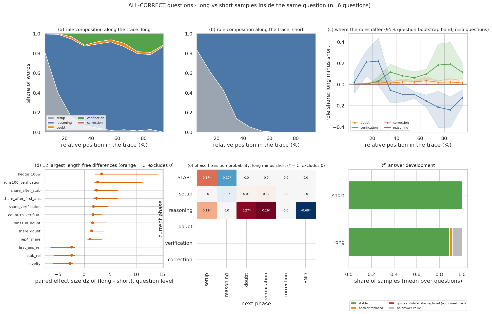

*Panel guide: (a)/(b) stacked role composition along the trace for long and short samples; (c) role-share difference long − short with a 95 % question-bootstrap band; (d) the 12 largest length-free effects with `dz` and CIs (orange = CI excludes 0); (e) phase-transition probability difference (long − short), `*` = CI excludes 0; (f) answer-development pattern mix.*

**Full effect table (long − short, 6 questions):**

| feature | n | long | short | Δ (long − short) [95 % CI] | dz | p(sign-flip) | sig |
|---|---:|---:|---:|---:|---:|---:|:---:|
| `share_setup` | 6 | 0.155 | 0.207 | -0.0521 [-0.113, 0.00367] | -0.624 | 0.193 |  |
| `share_reasoning` | 6 | 0.74 | 0.793 | -0.0533 [-0.138, 0.0278] | -0.464 | 0.315 |  |
| `share_doubt` | 6 | 0.0182 | 0 | 0.0182 [0.00907, 0.0277] | 1.453 | 0.0235 | ✓ |
| `share_verification` | 6 | 0.0871 | 0 | 0.0871 [0.0555, 0.124] | 1.808 | 0.034 | ✓ |
| `share_correction` | 6 | 0 | 0 | 0 [0, 0] | — | 1.000 |  |
| `changes_per100w` | 6 | 1.406 | 1.416 | -0.0105 [-0.163, 0.141] | -0.0516 | 0.915 |  |
| `runs100_doubt` | 6 | 0.162 | 0 | 0.162 [0.092, 0.238] | 1.632 | 0.03 | ✓ |
| `runs100_verification` | 6 | 0.237 | 0 | 0.237 [0.174, 0.299] | 2.604 | 0.0295 | ✓ |
| `runs100_correction` | 6 | 0 | 0 | 0 [0, 0] | — | 1.000 |  |
| `doubt_to_verif100` | 6 | 0.0604 | 0 | 0.0604 [0.038, 0.0853] | 1.740 | 0.0305 | ✓ |
| `doubt_to_corr100` | 6 | 0 | 0 | 0 [0, 0] | — | 1.000 |  |
| `verif_to_doubt100` | 6 | 0.00308 | 0 | 0.00308 [0, 0.00925] | 0.408 | 1.000 |  |
| `first_doubt_rel` | 0 | — | — | — | — | — | — |
| `first_verification_rel` | 0 | — | — | — | — | — | — |
| `first_correction_rel` | 0 | — | — | — | — | — | — |
| `first_ans_rel` | 6 | 0.665 | 0.96 | -0.295 [-0.384, -0.2] | -2.386 | 0.0335 | ✓ |
| `first_final_rel` | 6 | 0.982 | 1.000 | -0.0178 [-0.0296, -0.00644] | -1.033 | 0.054 | ✓ |
| `stab_rel` | 6 | 0.669 | 0.96 | -0.291 [-0.375, -0.202] | -2.387 | 0.027 | ✓ |
| `share_after_first_ans` | 6 | 0.335 | 0.04 | 0.295 [0.199, 0.384] | 2.386 | 0.0355 | ✓ |
| `share_after_stab` | 6 | 0.331 | 0.04 | 0.291 [0.202, 0.38] | 2.387 | 0.03 | ✓ |
| `n_replace_100w` | 6 | 0.00492 | 0 | 0.00492 [0, 0.0147] | 0.408 | 1.000 |  |
| `any_replace` | 6 | 0.0278 | 0 | 0.0278 [0, 0.0833] | 0.408 | 1.000 |  |
| `hedge_100w` | 6 | 0.907 | 0 | 0.907 [0.686, 1.078] | 3.381 | 0.0295 | ✓ |
| `novelty` | 6 | 0.513 | 0.691 | -0.178 [-0.226, -0.129] | -2.683 | 0.0275 | ✓ |
| `rep4_share` | 6 | 0.0657 | 0.0246 | 0.0411 [0.015, 0.0706] | 1.117 | 0.0685 | ✓ |
| `sent_repeat_share` | 6 | 0.0022 | 0 | 0.0022 [0, 0.00542] | 0.56 | 0.503 |  |
| `words` | 6 | 415.8 | 66.750 | 349.0 [258.3, 438.0] | 2.795 | 0.0295 | ✓ |
| `log_words` | 6 | 5.770 | 4.190 | 1.580 [1.245, 1.872] | 3.777 | 0.0275 | ✓ |
| `n_seg` | 6 | 37.452 | 4.877 | 32.575 [23.317, 43.611] | 2.445 | 0.0335 | ✓ |
| `mean_seg_words` | 6 | 12.660 | 14.050 | -1.391 [-3.598, 1.241] | -0.388 | 0.359 |  |
| `pat_stable` | 6 | 0.889 | 1.000 | -0.111 [-0.167, -0.0556] | -1.291 | 0.134 | ✓ |
| `pat_replaced` | 6 | 0.0278 | 0 | 0.0278 [0, 0.0833] | 0.408 | 1.000 |  |
| `pat_goldlost` | 6 | 0 | 0 | 0 [0, 0] | — | 1.000 |  |
| `pat_noanswer` | 6 | 0.0833 | 0 | 0.0833 [0.0278, 0.139] | 0.913 | 0.271 | ✓ |


**Reading:**

* **Short correct traces contain no doubt and no verification at all** (both shares exactly 0.000). Long correct traces devote **1.8 %** of words to doubt (dz = 1.45) and **8.7 %** to verification (dz = 1.81); they open `verification` phases 0.24× per 100 words (dz = 2.60) and follow `doubt → verification` 0.06× per 100 words (dz = 1.74). Correction never occurs in either side.
* **The answer comes much earlier in long traces:** first candidate at 66.5 % of the trace vs 96.0 % (dz = −2.39), first `final` at 98.2 % vs 100.0 % (dz = −1.03), so **33.5 % of the long trace is written after the answer exists vs 4.0 % of the short one** (dz = 2.39). In other words, a long correct sample does not "finally arrive" — it *arrives early and then keeps checking*.
* **Long correct traces are less novel and more repetitive:** novelty 0.513 vs 0.691 (dz = −2.68), 4-gram repetition 0.066 vs 0.025 (dz = 1.12), hedges 0.91 vs 0.0 per 100 words (dz = 3.38).
* **Nothing in the "how often the model changes gear" family moves:** `changes_per100w` 1.406 vs 1.416 (dz = −0.05) — the extra length is *more of the same phases*, not more phase switches.
* Length-free pattern shifts are small but consistent: `stable` 88.9 % vs 100 %, `no answer value` 8.3 % vs 0 % (long traces more often carry a long/code answer that cannot be normalised).
* Not significant: `share_setup`, `share_reasoning`, `mean_seg_words`, replacement rates (≈ 0 on both sides).

---

## 8. §7 MIXED questions

> *At least one correct and one incorrect sample. Question: inside the same question, how do incorrect samples differ from correct ones? No length filter — the comparison is by outcome.*

**167 questions** (the largest group, 4,120 eligible samples). This is the statistically strongest contrast of H3.

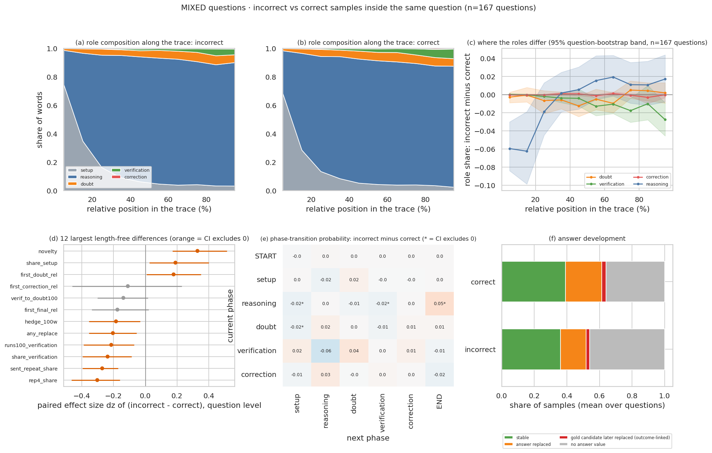

*Panel guide: (a) role composition of incorrect samples, (b) of correct samples, (c) incorrect − correct role-share difference with bootstrap band, (d) 12 largest length-free effects, (e) phase-transition difference matrix, (f) answer-development patterns.*

**Full effect table (incorrect − correct, 167 questions):**

| feature | n | incorrect | correct | Δ (incorrect − correct) [95 % CI] | dz | p(sign-flip) | sig |
|---|---:|---:|---:|---:|---:|---:|:---:|
| `share_setup` | 167 | 0.16 | 0.142 | 0.018 [0.00263, 0.0311] | 0.19 | 0.0145 | ✓ |
| `share_reasoning` | 167 | 0.775 | 0.781 | -0.00591 [-0.0198, 0.00769] | -0.0632 | 0.418 |  |
| `share_doubt` | 167 | 0.0464 | 0.0495 | -0.00309 [-0.00809, 0.00149] | -0.0975 | 0.194 |  |
| `share_verification` | 167 | 0.0164 | 0.0252 | -0.00879 [-0.0145, -0.00321] | -0.237 | 0.0025 | ✓ |
| `share_correction` | 167 | 0.00185 | 0.0021 | -0.000246 [-0.00103, 0.000523] | -0.0467 | 0.557 |  |
| `changes_per100w` | 167 | 1.434 | 1.430 | 0.00323 [-0.0694, 0.0831] | 0.00611 | 0.935 |  |
| `runs100_doubt` | 167 | 0.335 | 0.344 | -0.00933 [-0.0388, 0.0197] | -0.0491 | 0.529 |  |
| `runs100_verification` | 167 | 0.0515 | 0.0707 | -0.0192 [-0.0328, -0.00659] | -0.215 | 0.005 | ✓ |
| `runs100_correction` | 167 | 0.0165 | 0.0167 | -0.000207 [-0.00663, 0.00624] | -0.00494 | 0.951 |  |
| `doubt_to_verif100` | 167 | 0.012 | 0.0167 | -0.0046 [-0.0108, 0.00317] | -0.0962 | 0.231 |  |
| `doubt_to_corr100` | 167 | 0.00749 | 0.00507 | 0.00242 [-0.00151, 0.00634] | 0.0956 | 0.229 |  |
| `verif_to_doubt100` | 167 | 0.00253 | 0.00395 | -0.00142 [-0.00298, 0.000157] | -0.138 | 0.0725 |  |
| `first_doubt_rel` | 142 | 0.403 | 0.369 | 0.0331 [0.00145, 0.0627] | 0.178 | 0.037 | ✓ |
| `first_verification_rel` | 79 | 0.67 | 0.678 | -0.0157 [-0.074, 0.0441] | -0.0572 | 0.606 |  |
| `first_correction_rel` | 35 | 0.565 | 0.546 | -0.0334 [-0.132, 0.0675] | -0.11 | 0.523 |  |
| `first_ans_rel` | 139 | 0.697 | 0.671 | 0.0218 [-0.0125, 0.0554] | 0.106 | 0.209 |  |
| `first_final_rel` | 92 | 0.987 | 0.991 | -0.00441 [-0.00991, 0.000463] | -0.176 | 0.101 |  |
| `stab_rel` | 133 | 0.834 | 0.82 | 0.0129 [-0.0168, 0.0428] | 0.0743 | 0.396 |  |
| `share_after_first_ans` | 139 | 0.303 | 0.329 | -0.0218 [-0.0555, 0.0127] | -0.106 | 0.215 |  |
| `share_after_stab` | 133 | 0.166 | 0.18 | -0.0129 [-0.0415, 0.0172] | -0.0743 | 0.384 |  |
| `n_replace_100w` | 167 | 0.0567 | 0.0585 | -0.00178 [-0.0203, 0.0205] | -0.0133 | 0.882 |  |
| `any_replace` | 167 | 0.177 | 0.238 | -0.0613 [-0.108, -0.0152] | -0.204 | 0.009 | ✓ |
| `hedge_100w` | 167 | 1.246 | 1.337 | -0.0911 [-0.166, -0.0165] | -0.185 | 0.022 | ✓ |
| `novelty` | 167 | 0.534 | 0.499 | 0.0346 [0.019, 0.0507] | 0.328 | 0.0005 | ✓ |
| `rep4_share` | 167 | 0.0784 | 0.0941 | -0.0157 [-0.0244, -0.00829] | -0.303 | 0.0005 | ✓ |
| `sent_repeat_share` | 167 | 0.00804 | 0.0138 | -0.0058 [-0.00924, -0.00282] | -0.272 | 0.0005 | ✓ |
| `words` | 167 | 735.6 | 908.0 | -172.5 [-273.1, -85.834] | -0.285 | 0.001 | ✓ |
| `log_words` | 167 | 6.045 | 6.291 | -0.246 [-0.338, -0.159] | -0.414 | 0.0005 | ✓ |
| `n_seg` | 167 | 49.649 | 63.100 | -13.452 [-20.732, -6.848] | -0.304 | 0.0005 | ✓ |
| `mean_seg_words` | 167 | 15.617 | 15.297 | 0.32 [-0.125, 0.812] | 0.106 | 0.177 |  |
| `pat_stable` | 167 | 0.36 | 0.392 | -0.0318 [-0.0765, 0.0125] | -0.106 | 0.191 |  |
| `pat_replaced` | 167 | 0.157 | 0.221 | -0.0638 [-0.108, -0.0209] | -0.225 | 0.0045 | ✓ |
| `pat_goldlost` | 167 | 0.0212 | 0.0278 | -0.00658 [-0.021, 0.00861] | -0.067 | 0.381 |  |
| `pat_noanswer` | 167 | 0.461 | 0.359 | 0.102 [0.0557, 0.152] | 0.321 | 0.0005 | ✓ |


**Reading:**

* **Correct samples are the longer ones** — mean 908 vs 736 words (Δ = −172, CI [−273, −86]), Δ log-words −0.246 (dz = −0.41) ⇒ a typical correct sample is ≈ 1.3× the length of an incorrect one of the same question; they also carry more segments (63.1 vs 49.6). The within-question form of "more thinking ↔ better outcome".
* **Verification separates the outcomes most cleanly:** `share_verification` 0.016 (incorrect) vs **0.025** (correct), Δ = −0.0088, CI [−0.014, −0.003], dz = −0.237, p = 0.0025; `runs100_verification` 0.051 vs 0.071 (dz = −0.215, p = 0.005). Correction and doubt shares do **not** differ.
* **Incorrect traces re-read the question more** (`share_setup` +0.018, dz = 0.19) and **start doubting later** (`first_doubt_rel` 0.403 vs 0.369, dz = 0.18).
* **Incorrect traces are more novel, less repetitive:** novelty 0.534 vs 0.499 (dz = 0.33, p = 0.0005), `rep4_share` 0.078 vs 0.094 (dz = −0.30, p = 0.0005), `sent_repeat_share` 0.008 vs 0.014 (dz = −0.27, p = 0.0005) — correct samples loop over their own content slightly more (they are re-checking it), incorrect ones keep generating new content.
* **Answer behaviour:** an answer is replaced at least once in 17.7 % of incorrect vs 23.8 % of correct samples (`any_replace` dz = −0.20, p = 0.009) and the `answer replaced` pattern is 15.7 % vs 22.1 % — i.e. *correct* samples churn their answer more, but per-100-word replacement rates are equal (0.057 vs 0.058, n.s.), so the difference is a consequence of the longer traces having more room for it. `no answer value` is markedly higher for incorrect samples (46.1 % vs 35.9 %, dz = 0.32).
* **Hedges are slightly rarer in incorrect samples** (1.246 vs 1.337 per 100 words, dz = −0.18) — the "wait / maybe / let me check" register tracks the correct side.
* Not significant: `share_reasoning`, `share_doubt`, `share_correction`, `changes_per100w`, `first_ans_rel`, `stab_rel`, `gold candidate later replaced` (2.1 % vs 2.8 %).

---

## 9. §8 ALL-WRONG questions

> *Every eligible sample is incorrect. Question: do the longer wrong samples differ from the shorter wrong ones? Same length-significance rule as the ALL-CORRECT section (notebook §6).*

**58 ALL-WRONG questions, 12 with a significant length spread**, median long/short ratio ≈ **13.7×** (Δ log-words 2.616 — the most extreme length contrast in H3).

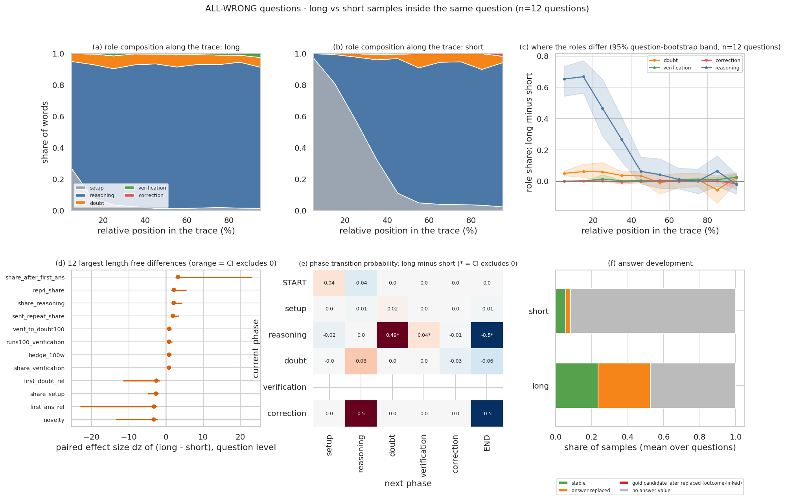

**Full effect table (long − short, 12 questions):**

| feature | n | long | short | Δ (long − short) [95 % CI] | dz | p(sign-flip) | sig |
|---|---:|---:|---:|---:|---:|---:|:---:|
| `share_setup` | 12 | 0.0491 | 0.297 | -0.248 [-0.297, -0.196] | -2.709 | 0.001 | ✓ |
| `share_reasoning` | 12 | 0.879 | 0.658 | 0.221 [0.16, 0.275] | 2.073 | 0.001 | ✓ |
| `share_doubt` | 12 | 0.0641 | 0.0429 | 0.0212 [0.00287, 0.0399] | 0.631 | 0.0535 | ✓ |
| `share_verification` | 12 | 0.00681 | 0 | 0.00681 [0.00261, 0.012] | 0.789 | 0.005 | ✓ |
| `share_correction` | 12 | 0.00105 | 0.0027 | -0.00165 [-0.00754, 0.00173] | -0.173 | 1.000 |  |
| `changes_per100w` | 12 | 1.061 | 1.355 | -0.294 [-0.703, 0.117] | -0.372 | 0.241 |  |
| `runs100_doubt` | 12 | 0.38 | 0.284 | 0.0961 [-0.0686, 0.238] | 0.331 | 0.271 |  |
| `runs100_verification` | 12 | 0.0228 | 0 | 0.0228 [0.00984, 0.0401] | 0.808 | 0.0035 | ✓ |
| `runs100_correction` | 12 | 0.00795 | 0.0199 | -0.0119 [-0.055, 0.0131] | -0.169 | 1.000 |  |
| `doubt_to_verif100` | 12 | 0.00205 | 0 | 0.00205 [0, 0.0052] | 0.368 | 0.501 |  |
| `doubt_to_corr100` | 12 | 0.00393 | 0.0129 | -0.00896 [-0.0366, 0.00667] | -0.194 | 1.000 |  |
| `verif_to_doubt100` | 12 | 0.00789 | 0 | 0.00789 [0.00303, 0.0132] | 0.85 | 0.017 | ✓ |
| `first_doubt_rel` | 8 | 0.136 | 0.471 | -0.384 [-0.477, -0.285] | -2.599 | 0.01 | ✓ |
| `first_verification_rel` | 0 | — | — | — | — | — | — |
| `first_correction_rel` | 1 | 0.444 | 0.656 | — | — | — | — |
| `first_ans_rel` | 3 | 0.511 | 0.785 | -0.213 [-0.261, -0.138] | -3.215 | 0.253 | ✓ |
| `first_final_rel` | 1 | 0.999 | 1.000 | — | — | — | — |
| `stab_rel` | 2 | 0.72 | 0.885 | — | — | — | — |
| `share_after_first_ans` | 3 | 0.489 | 0.215 | 0.213 [0.138, 0.261] | 3.215 | 0.257 | ✓ |
| `share_after_stab` | 2 | 0.28 | 0.115 | — | — | — | — |
| `n_replace_100w` | 12 | 0.0141 | 0.0253 | -0.0112 [-0.0668, 0.0225] | -0.124 | 1.000 |  |
| `any_replace` | 12 | 0.289 | 0.0278 | 0.261 [0.0833, 0.445] | 0.787 | 0.0385 | ✓ |
| `hedge_100w` | 12 | 1.931 | 1.247 | 0.683 [0.227, 1.156] | 0.807 | 0.0135 | ✓ |
| `novelty` | 12 | 0.253 | 0.665 | -0.411 [-0.473, -0.339] | -3.308 | 0.0015 | ✓ |
| `rep4_share` | 12 | 0.222 | 0.0366 | 0.186 [0.136, 0.227] | 2.140 | 0.0005 | ✓ |
| `sent_repeat_share` | 12 | 0.0284 | 0 | 0.0284 [0.0199, 0.0374] | 1.841 | 0.0025 | ✓ |
| `words` | 12 | 3826.7 | 240.9 | 3585.8 [2766.9, 4333.8] | 2.413 | 0.001 | ✓ |
| `log_words` | 12 | 8.032 | 5.416 | 2.616 [2.263, 2.895] | 4.438 | 0.0015 | ✓ |
| `n_seg` | 12 | 215.8 | 14.642 | 201.2 [148.9, 252.8] | 2.094 | 0.0005 | ✓ |
| `mean_seg_words` | 12 | 18.012 | 16.853 | 1.159 [-0.214, 2.843] | 0.416 | 0.191 |  |
| `pat_stable` | 12 | 0.236 | 0.0556 | 0.181 [0.0694, 0.306] | 0.826 | 0.0395 | ✓ |
| `pat_replaced` | 12 | 0.289 | 0.0278 | 0.261 [0.0833, 0.45] | 0.787 | 0.0315 | ✓ |
| `pat_goldlost` | 12 | 0 | 0 | 0 [0, 0] | — | 1.000 |  |
| `pat_noanswer` | 12 | 0.475 | 0.917 | -0.442 [-0.639, -0.247] | -1.246 | 0.0085 | ✓ |


**Reading:**

* **Setup collapses.** Short wrong samples spend 29.7 % of their words restating the problem; long wrong samples only 4.9 % (Δ = −0.248, dz = −2.71, p = 0.001). Reasoning absorbs it: 65.8 % → 87.9 % (dz = 2.07).
* **Long wrong traces loop instead of exploring.** `rep4_share` 0.037 → 0.222 (dz = 2.14, p = 0.0005), `sent_repeat_share` 0.000 → 0.028 (dz = 1.84), while **novelty collapses 0.665 → 0.253** (dz = −3.31). Six-fold repetition with a third of the new content: this is the signature of a failing long run.
* **Doubt arrives early and stays.** `first_doubt_rel` 0.471 → 0.136 (dz = −2.60, p = 0.010); `share_doubt` +0.021 (dz = 0.63); `verif_to_doubt100` 0 → 0.008 (dz = 0.85) — checks decay back into doubt rather than resolving.
* **Verification appears only in long wrong traces** (`share_verification` 0 → 0.0068, dz = 0.79; `runs100_verification` 0 → 0.023, dz = 0.81) — but at a fraction of the 8.7 % seen in long *correct* traces (§7): checking alone does not rescue the answer.
* **Answer churn explodes:** `any_replace` 2.8 % → 28.9 % (dz = 0.79), `pat_replaced` same figures, `pat_noanswer` 91.7 % → 47.5 % (dz = −1.25) — short wrong samples mostly never write a normalisable answer at all, long ones keep rewriting one. (`first_ans_rel` and `first_final_rel` rest on only 3 and 1 questions respectively and are reported for completeness only.)
* **Hedges double:** 1.247 → 1.931 per 100 words (dz = 0.81).
* Not significant: `changes_per100w` (1.355 → 1.061, dz = −0.37, CI crosses 0 — long wrong traces switch gear *less* often), `share_correction`, `doubt_to_corr100`, `mean_seg_words`.

---

## 10. §9 Group comparison (five conditions)

Five conditions side by side, each a question-level mean: **ALL-CORRECT short**, **ALL-CORRECT long** (shortest/longest 25 % of each question's samples), **MIXED correct**, **MIXED incorrect**, **ALL-WRONG** (all samples). With `CMP_LEN_SIG_ONLY = True` the ALL-CORRECT and ALL-WRONG sides are restricted to length-significant questions — exactly as in §7/§9 (n = 6 and n = 12); MIXED is compared by outcome and never length-filtered (n = 167).

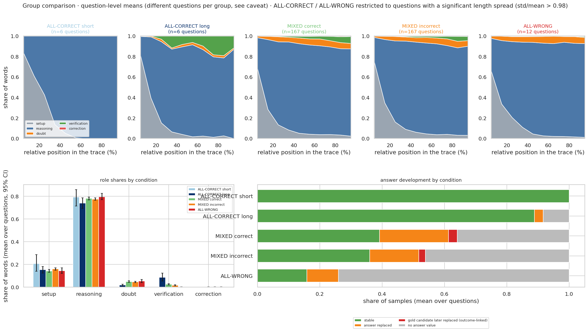

*Top row: role composition along the trace per condition (n in each title; the run used the threshold `std/mean > 0.98`). Bottom left: role shares by condition with 95 % CIs. Bottom right: answer-development pattern mix per condition.*

**Full table (question-level means; 95 % CIs in the CSV):**

| feature | ALL-CORRECT short | ALL-CORRECT long | MIXED correct | MIXED incorrect | ALL-WRONG |
|---|---:|---:|---:|---:|---:|
| `share_doubt` | 0 | 0.0182 | 0.0495 | 0.0464 | 0.054 |
| `share_verification` | 0 | 0.0871 | 0.0252 | 0.0164 | 0.00233 |
| `share_correction` | 0 | 0 | 0.0021 | 0.00185 | 0.00202 |
| `share_reasoning` | 0.793 | 0.74 | 0.781 | 0.775 | 0.796 |
| `changes_per100w` | 1.416 | 1.406 | 1.430 | 1.434 | 1.196 |
| `first_ans_rel` | 0.96 | 0.665 | 0.671 | 0.697 | 0.591 |
| `share_after_first_ans` | 0.04 | 0.335 | 0.329 | 0.303 | 0.409 |
| `n_replace_100w` | 0 | 0.00492 | 0.0585 | 0.0567 | 0.0119 |
| `rep4_share` | 0.0246 | 0.0657 | 0.0941 | 0.0784 | 0.12 |
| `hedge_100w` | 0 | 0.907 | 1.337 | 1.246 | 1.647 |
| `log_words` | 4.190 | 5.770 | 6.291 | 6.045 | 6.697 |


`n_questions` per condition: 6 / 6 / 167 / 167 / 12. For the answer-position features (`first_ans_rel`, `share_after_first_ans`) only questions whose samples carry an annotated answer contribute: 6 / 6 / 149 / 149 / 10.

**Reading:**

* **`setup` share falls monotonically with worse outcome/longer traces:** 0.207 (AC short) → 0.155 (AC long) → 0.142 (MIXED correct) → 0.160 (MIXED incorrect) → **0.049** (ALL-WRONG long-dominated).
* **`verification` is the opposite:** 0.000 (AC short) → **0.087** (AC long) → 0.025 (MIXED correct) → 0.016 (MIXED incorrect) → 0.002 (ALL-WRONG). Highest where the model is both correct and forced to think long.
* **`rep4_share` rises 0.025 → 0.066 → 0.078/0.094 → 0.120** across AC-short, AC-long, MIXED-inc/corr, ALL-WRONG, and `hedge_100w` follows (0.000 → 0.907 → 1.246/1.337 → 1.647): repetition and hedging track *difficulty of the outcome*, novelty does the opposite.
* **Answer development:** `stable` 100 % (AC short) → 88.9 % (AC long) → ~39 %/36 % (MIXED) → 23.6 % (ALL-WRONG); `no answer value` 0 % → 8.3 % → 35.9 %/46.1 % → 47.5 %.
* **Length:** `log_words` 4.19 → 5.77 → 6.29 (correct) → 6.05 (incorrect) → 6.70 — MIXED *correct* samples are longer than MIXED *incorrect* ones, and the ALL-WRONG condition sits highest of all.

> **Caveat (stated by the notebook itself):** ALL-CORRECT, MIXED and ALL-WRONG contain *different questions*, typically of different difficulty. These differences show **where the groups sit relative to each other, not what causes an outcome**. Only the within-question contrasts of §7–§9 support that reading; the only within-question part of this figure is ALL-CORRECT short vs long.

---

## 11. Example trajectory figures (5 per group)

Each figure shows one question: one panel per compute level, samples of that level only, shortest at the top, word positions on each panel's own scale (so panels are compared by *shape*, not by absolute length). Saved under `…/figures/examples/<GROUP>/`; the notebook displays 75 % of the questions of each group interactively and writes only these 5 "representative" ones (closest to the group median on log mean length, log length spread and accuracy).

### 11.1 ALL-CORRECT

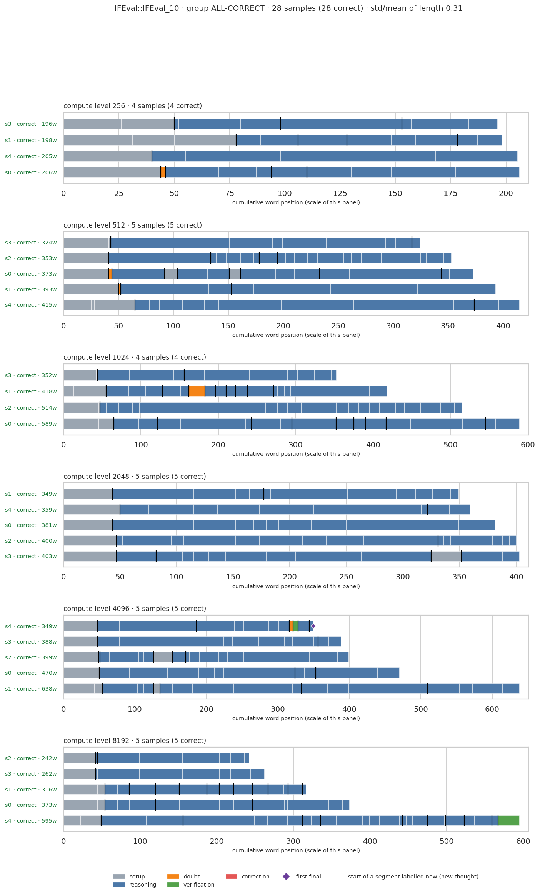

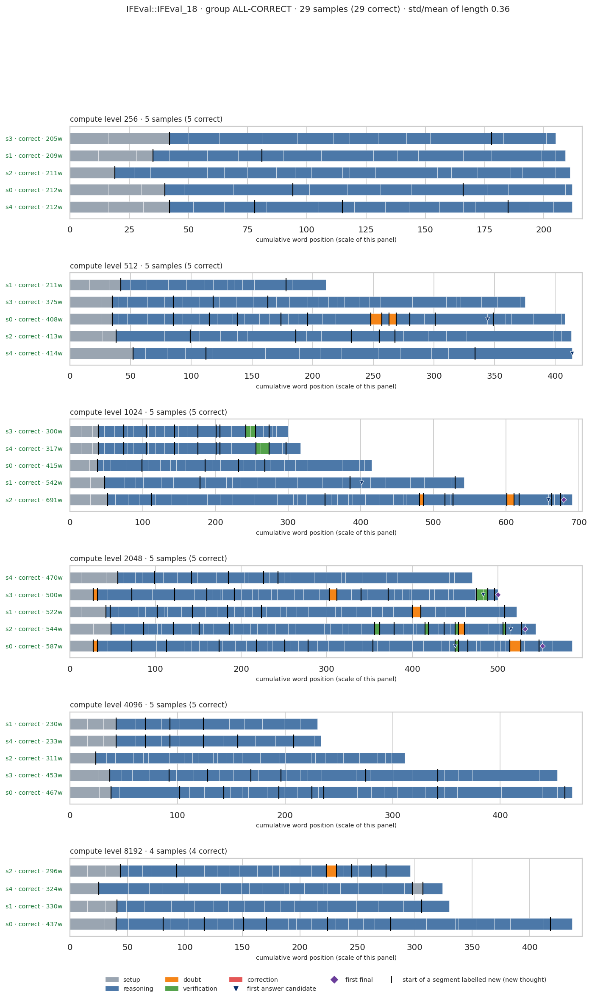

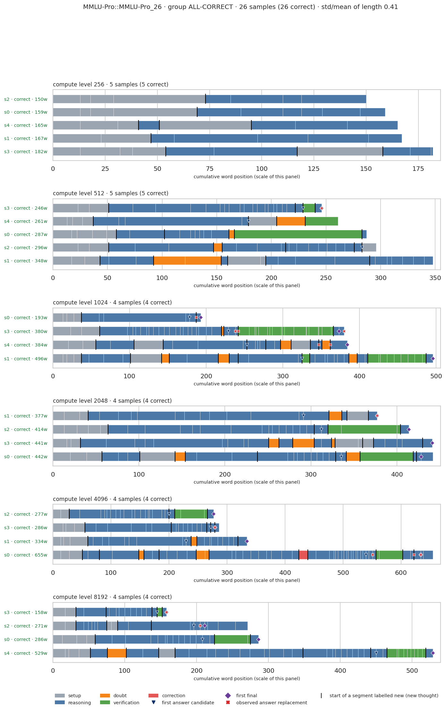

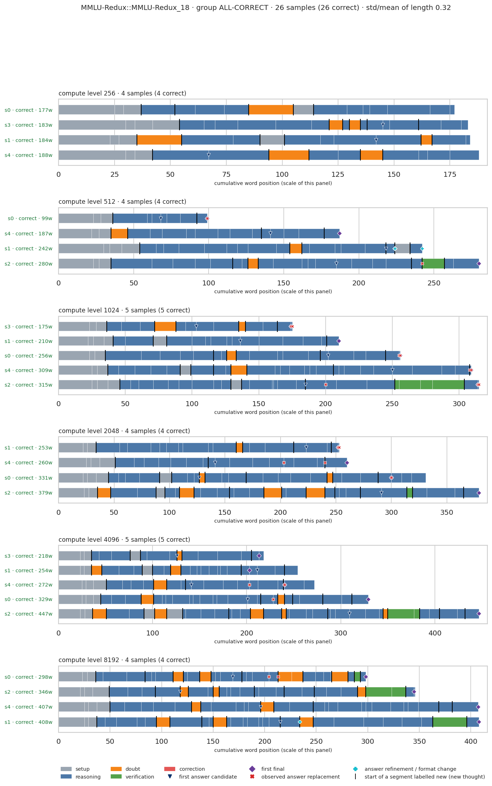

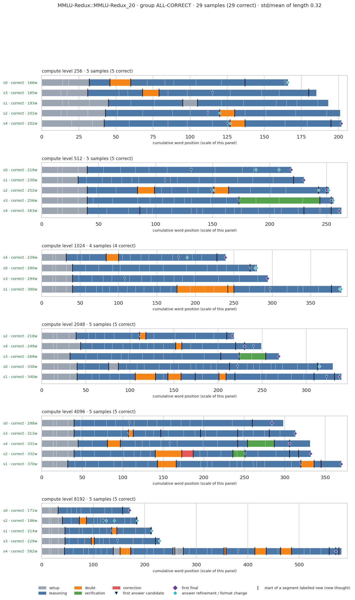

*What to look for (e.g. `MMLU-Redux_20`: 29 samples, 29 correct, length spread std/mean 0.32): the grey `setup` block ends within the first ~20 % of every row, `doubt` (orange) appears as isolated islands only from compute level 256 upward, `verification` (green) shows up sporadically from 512, and `▼`/`◆` markers cluster in the last third — the §7 signature of "short = straight to the point, long = answer early, then check".*

### 11.2 MIXED

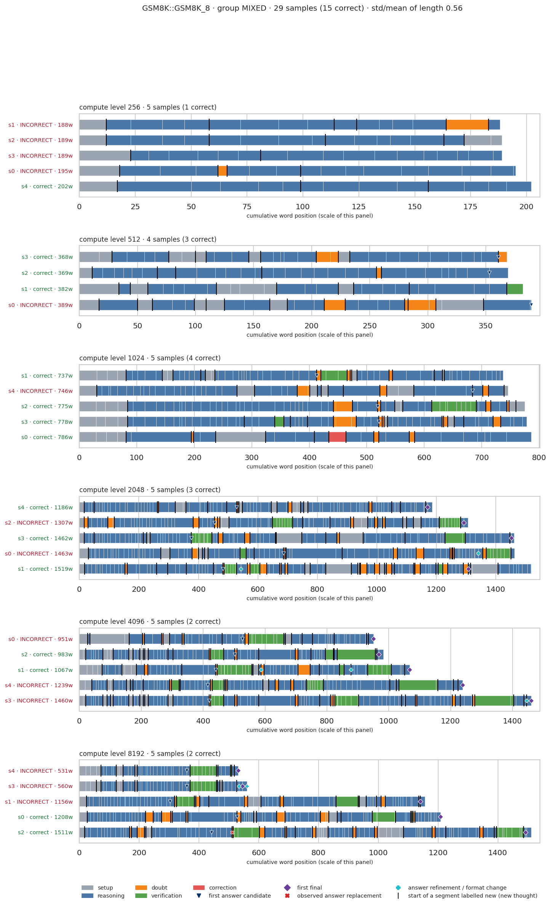

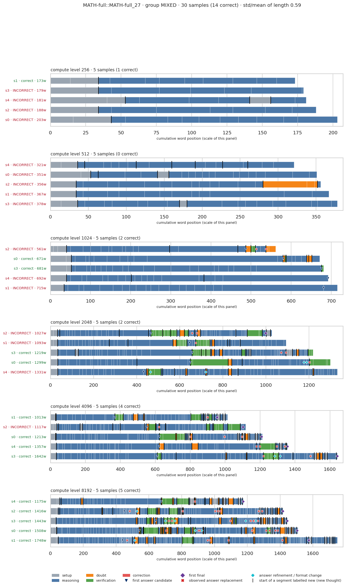

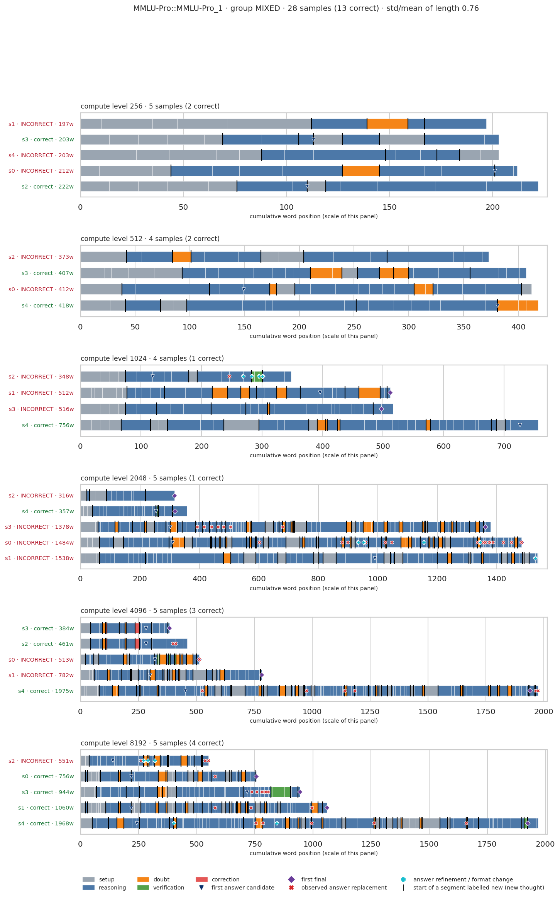

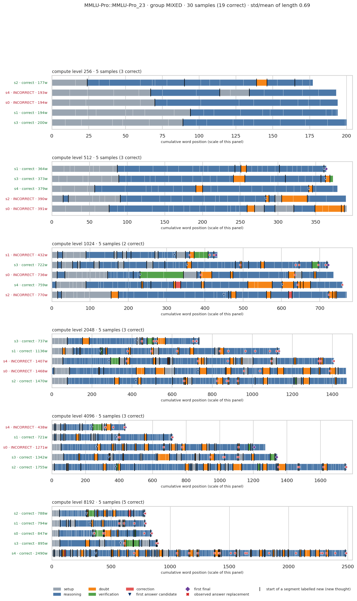

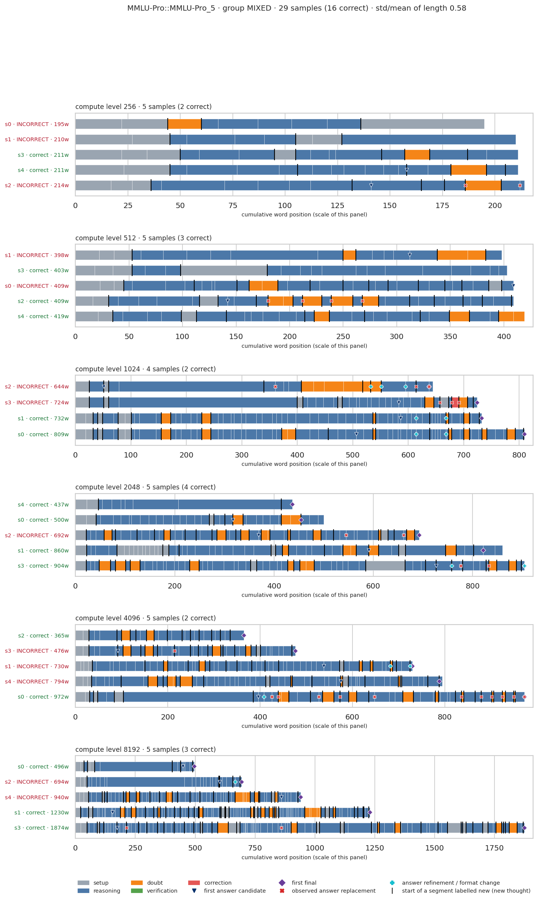

*What to look for (e.g. `MMLU-Pro_23`: 30 samples, 19 correct, std/mean 0.69, panels 256 → 8192): green correct and red INCORRECT rows are interleaved at every level; correctness does not visibly "look like" anything on a single row — the systematic differences only appear when the 167 questions are pooled (§8). Watch instead for the density of green `verification` blocks and the red `✕` replacement markers, which the pooled tables show are outcome-linked; the 8192 panel shows the length explosion (one 2,490-word row beside 788–895-word rows).*

### 11.3 ALL-WRONG

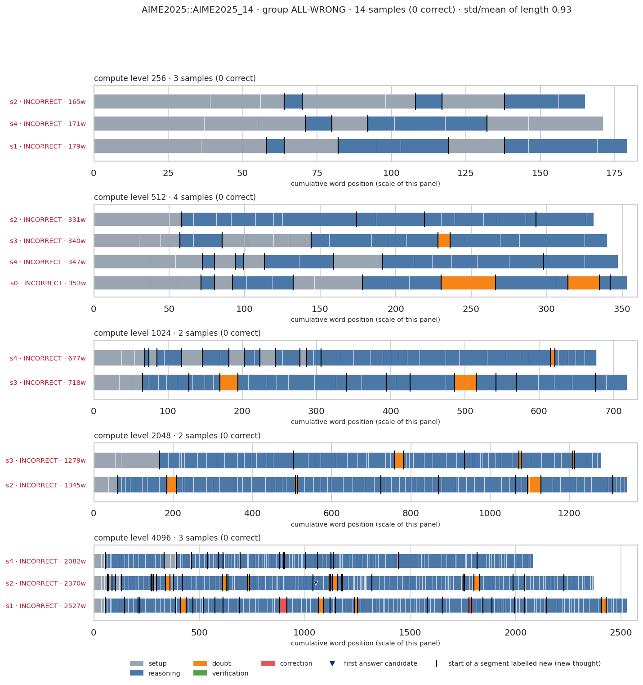

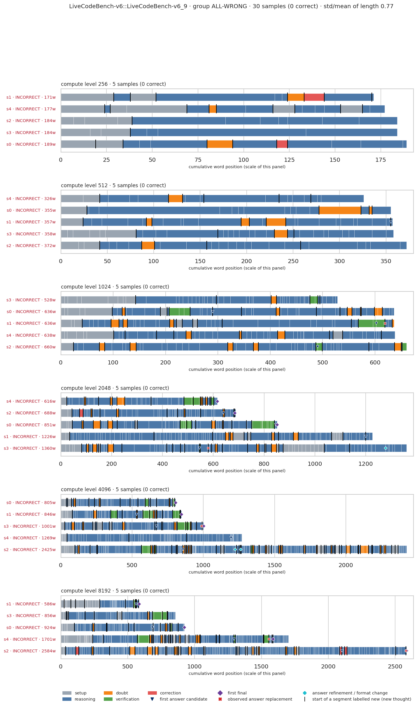

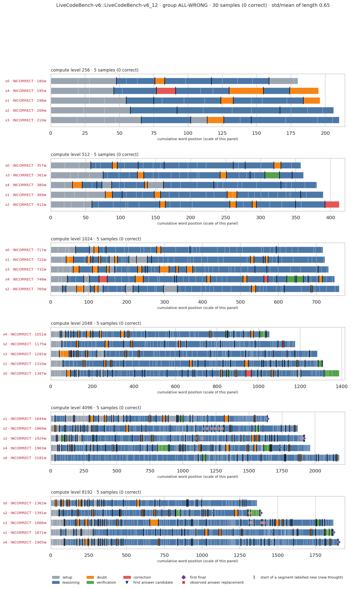

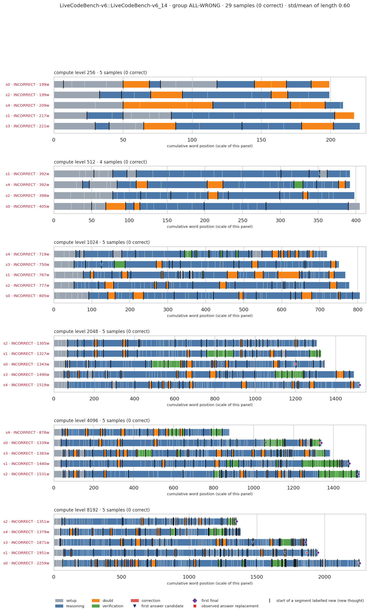

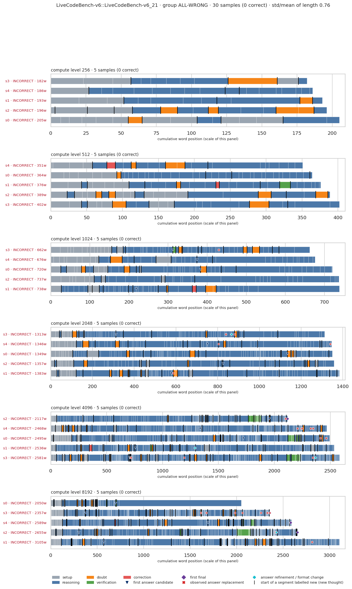

*What to look for (e.g. `AIME2025_14`: 14 samples, 0 correct, std/mean 0.93): rows grow from 165 to 2,527 words while the grey `setup` prefix *shrinks* in relative terms — by level 4096 it is a sliver at the left edge, and the rest is a nearly unbroken band of blue reasoning with black `new`-thought separators every few dozen words (the §9 repetition signature). Only one `▼` candidate marker appears in the whole figure: long failing runs often never commit to a normalisable answer.*

---

## 12. Discussion — what extra compute is actually spent on

1. **Length alone is not a behaviour.** The three contrasts disagree in instructive ways. In *correct* runs, extra length buys **self-checking** (doubt 0 → 1.8 %, verification 0 → 8.7 %, answer at 66 % of the trace with a third of the trace left to verify it). In *failing* runs, extra length buys **looping** (repetition ×6, novelty ÷2.6, setup halved-and-halved-again, doubt from 13.6 % of the way in). In *mixed* runs, the difference between outcomes is not how much the model doubts (equal) but how much it **verifies**.
2. **Verification, not doubt, tracks success.** `share_doubt` is statistically indistinguishable between correct and incorrect samples within a question (Δ = −0.003, n = 167), while `share_verification` and `runs100_verification` both separate them at p < 0.01. Doubt is the cheap signal; performing the check is the expensive one.
3. **Repetition and hedging are difficulty meters.** Across the five conditions both rise monotonically as the outcome worsens (0.025 → 0.120 and 0.000 → 1.647), in *both* length contrasts and in the outcome contrast — the most robust cross-section pattern in H3.
4. **Answer churn matters through outcomes, not through rate.** Within MIXED questions the per-word replacement rate is identical, yet correct samples replace an answer at least once far more often (23.8 % vs 17.7 %) — they are long enough to reach an answer, reject it and reach a better one. In ALL-WRONG the churn is one-sided (2.8 % → 28.9 % short → long) and paired with a collapse in `no answer value` (91.7 % → 47.5 %).
5. **Nothing here is causal.** The design is observational and the compute level is pooled away; §10's five-condition table in particular compares different questions.

## 13. Limitations

* **Cross-group confound** — ALL-CORRECT/MIXED/ALL-WRONG contain different questions of different difficulty; only the within-question contrasts (§7–§9) support outcome statements.
* **Labeler dependence** — every `discourse_role`/`answer_status` comes from one judge model (Qwen3.5-9B-AWQ, greedy, one worked example). The consistency fixes in `enforce_rules()` are mechanical, not validation; no human agreement study is stored in the repo.
* **Input provenance** — the labeler's `SECOND_HALF_ONLY=True` flag and the 62 missing `8192` rows (§2): the analysed file is the committed 9,450-row raw sweep minus those 62 rows, while the Kaggle-side segmented input evidently held ~18,776 rows. All analysed keys are unique, so no sample is counted twice.
* **Small n in the length contrasts** — 6 (ALL-CORRECT) and 12 (ALL-WRONG) questions; several answer-position features fall back to n = 0–3 and are listed only for completeness. Wilcoxon/sign-flip p-values are exploratory with **no multiplicity correction** across 34 features × 3 contrasts.
* **Truncation excluded** — 906 truncated rows are dropped (they are exactly the largest compute levels), so the analysis never sees budget-exhaustion failures.
* **Cleared notebook outputs** — notebooks 1 and 2 are committed without their outputs; every number in this document was taken from the saved tables in `results/`, except the eligibility funnel and data-quality counts, which were recomputed from the labelled CSV with the notebook's own rules and reproduce `question_groups.csv` exactly (6,575 samples / 270 questions).
* **Doc/code drift** — the 75 % vs 85 % length-quantile discrepancy noted in §6.2.

## 14. Reproduction guide

**Stage 0 (local).** Open `0.sentence_segmentation.ipynb`, point `INPUT_PATH`/`OUTPUT_PATH` at the r1-llama8b raw/processed CSVs, run top to bottom; inspect the preview (section 4) before the save cell. Round-trip and acceptance tests must print `All acceptance tests passed.`

**Stage 1 (Kaggle, GPU T4 × 2 + Internet).** Upload/point `CFG.INPUT_FILENAME` at `r1-llama8b_raw_results_segmented.csv` (cell 1 pulls it from dataset `tharwatzzzz111/dataseta`), run cells 1–9 (installs vLLM, downloads the model, starts and smoke-tests both servers), then cell 10 for a visual quality check, then cell 11 for the run. Interrupt-safe: rerun cell 11 to resume; changing prompt/example/model/`CHUNK_SIZE` invalidates the checkpoint automatically. Outputs land in `/kaggle/working/` and must be downloaded into `src/data/processed/r1-llama8b/` as `r1-llama8b_raw_results_segmented_labeled.csv`.

**Stage 2 (local).**

```bash
# defaults baked into the notebook:
#   TRACE_CSV = ../../data/processed/r1-llama8b/r1-llama8b_raw_results_segmented_labeled.csv
#   TRACE_OUT = ../../results/r1-llama8b/textual_analysis
python -c "import jupyter"  # notebook run: 2_reasoning_trace_trajectory_analysis.ipynb, top to bottom
```

Environment overrides: `TRACE_CSV`, `TRACE_OUT`, `TRACE_LEN_Q` (length-significance quantile, default 0.85). Needs `pandas`, `numpy`, `matplotlib`, `seaborn`, `scipy`, `scikit-learn` (for `ENGLISH_STOP_WORDS`). Expected output: the four `overall_*.png`, 15 `examples/**/*.png` and five CSVs listed in §3.1.

## 15. Artifact index

| Section of this report | Produced by | File |
|---|---|---|
| §4 | `0.sentence_segmentation.ipynb` | segmented CSV (not committed; staged on Kaggle) |
| §5 | `1.reasoning_trace_labeler.ipynb` | `r1-llama8b_raw_results_segmented_labeled.csv` |
| §6.5 | `2_…ipynb` §5 | [`tables/question_groups.csv`](../../results/r1-llama8b/textual_analysis/tables/question_groups.csv) |
| §7 | `2_…ipynb` §6 | [`tables/ALL-CORRECT_long_vs_short.csv`](../../results/r1-llama8b/textual_analysis/tables/ALL-CORRECT_long_vs_short.csv), [`figures/overall_ALL-CORRECT_long_vs_short.png`](../../results/r1-llama8b/textual_analysis/figures/overall_ALL-CORRECT_long_vs_short.png) |
| §8 | `2_…ipynb` §7 | [`tables/MIXED_incorrect_vs_correct.csv`](../../results/r1-llama8b/textual_analysis/tables/MIXED_incorrect_vs_correct.csv), [`figures/overall_MIXED_incorrect_vs_correct.png`](../../results/r1-llama8b/textual_analysis/figures/overall_MIXED_incorrect_vs_correct.png) |
| §9 | `2_…ipynb` §8 | [`tables/ALL-WRONG_long_vs_short.csv`](../../results/r1-llama8b/textual_analysis/tables/ALL-WRONG_long_vs_short.csv), [`figures/overall_ALL-WRONG_long_vs_short.png`](../../results/r1-llama8b/textual_analysis/figures/overall_ALL-WRONG_long_vs_short.png) |
| §10 | `2_…ipynb` §9 | [`tables/group_comparison.csv`](../../results/r1-llama8b/textual_analysis/tables/group_comparison.csv), [`figures/overall_group_comparison.png`](../../results/r1-llama8b/textual_analysis/figures/overall_group_comparison.png) |
| §11 | `2_…ipynb` §6.1/§7.1/§8.1 | `figures/examples/{ALL-CORRECT,MIXED,ALL-WRONG}/*.png` |
